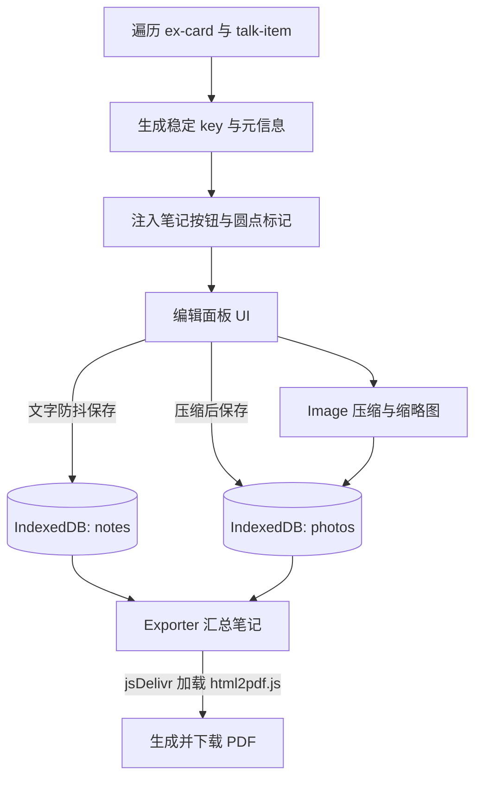

## 用户原始需求
「增加给每个项目写笔记的功能，数据完全存储在浏览器内，增加一份完整笔记内容的导出功能」（"到处"为"导出"笔误）。经确认：范围含展览与开幕周活动；笔记为文字并可附照片；导出为 PDF，允许通过 jsDelivr 等 CDN 引入在线 JS 库。

## 产品概述
在现有「2026 集美·阿尔勒导览」单页上，为每一个展览卡片和每一场开幕周活动增加个人笔记：可写文字、可附照片，内容只保存在当前浏览器；并提供一个全局入口，把所有笔记汇总导出成一份 PDF。

## 核心功能
- 逐项笔记：每个展览卡片、每个活动条目都有笔记入口，点击展开编辑，不影响原有浏览与切换标签。
- 文字 + 照片：多行文字自动保存，可添加、预览、删除多张照片。
- 本地存储：所有文字与照片仅存于浏览器，刷新后仍在，不上传服务器。
- 完整导出：一键把所有笔记（含照片）按导览顺序汇总，导出为一份 PDF。
- 状态反馈：有笔记的项目显示标记，编辑时显示保存状态与错误提示。


## 技术栈选择
- 沿用现有纯静态单文件方案：原生 HTML + CSS + JavaScript，无框架、无构建、无服务端，保持现有 ES5 风格（`var`、`function`）与 `:root` 变量体系。
- 存储：浏览器原生 IndexedDB，设 `notes` 与 `photos` 两个对象仓库；照片以客户端压缩后的 Blob 保存。localStorage 仅约 5MB，不足以承载照片，故选 IndexedDB。
- PDF：通过 jsDelivr CDN 懒加载 html2pdf.js（含 html2canvas + jsPDF），以 DOM 截图方式生成，中文无需嵌入字体文件即可正常显示。
- 图片压缩：Canvas + `toBlob`，完全浏览器端完成，数据不出本地。

## 实现方案
在不改动 40 多个元素 HTML 结构的前提下，脚本启动时遍历 `.ex-card` 与 `.talk-item`，由标题文本规范化生成稳定项目 key 并写入 `data-note-key`，同时从最近的楼层组/场馆、日期块推导展示与导出用的元信息。所有交互收敛为一个 IIFE 模块 `NotesApp`，含 Storage、UI、Image、Exporter 四个内部对象，注入一次全局编辑面板与全局导出按钮，避免重复 DOM。文字改动防抖 500ms 自动保存；照片在选定后立即压缩、入库并刷新缩略图。

关键决策与权衡：
- 双对象仓库：照片单独存，note 只存 `photoIds`，避免每次文字自动保存都重写大 Blob，读取缩略图也更省。
- DOM 截图式 PDF：相比 jsPDF 直接排版，中文与照片处理更简单可靠；代价是导出依赖 CDN 且大图较多时耗时，需压缩图片并显示进度。
- 由标题生成 key：省去手工加 40+ 个 id；对重复标题按出现顺序追加序号，保证稳定。

性能与可靠性：
- 初始化只做一次 `getAllNotes()`（不含 Blob）建立"是否有笔记"索引用于圆点标记；完整数据与照片在打开编辑面板时按需读取。
- 文本保存防抖、缩略图使用 `URL.createObjectURL` 并在关闭/删除时 `revokeObjectURL`，避免内存泄漏。
- IndexedDB 不可用（隐私模式）、配额超限、CDN 加载失败均给出明确降级提示，不阻断原有导览功能。

避免技术债：复用现有 `--accent`、`--radius`、`--shadow` 与系统字体栈；不引入构建工具或框架；不改动 `switchTab`/`switchVenue` 逻辑。

## 实现要点（执行细节）
- 目标元素：`.ex-card`（标题 `h3`）与 `.talk-item`（标题 `h4`）；元信息取最近的 `.floor-group .badge` / `.venue-head h2` / `.day-head .day`。
- 卡片入口按钮定位在卡片右下角，有笔记时加 `.has-note` 显示小圆点；按钮用 `stopPropagation` 避免触发链接。
- 编辑面板：标题 + 元信息、textarea、照片缩略图条、"添加照片" label（隐藏 `input[type=file][accept=image/*][multiple]`）、状态文字（编辑中/保存中/已保存时间）、删除笔记、关闭。
- 压缩参数：最长边 1280px、JPEG 质量 0.8；单项目照片上限约 9 张，超出给出提示。
- 导出：按 DOM 顺序收集有内容的笔记构建离屏容器（标题、元信息、正文 `white-space: pre-wrap`、照片），等待所有图片 `onload` 后再生成；配置 A4、页边距、`pagebreak.avoid` 指向单条笔记样式类。
- 文件名：`集美阿尔勒2026-我的笔记.pdf`；空数据时提示"还没有笔记可导出"。
- 均可直接以 `file://` 或静态托管运行；CDN 脚本仅导出时需联网。

## 架构设计
单文件内逻辑分层：页面既有内容层保持不变；新增 NotesApp 模块作为并行层。



数据流：用户编辑 → UI 更新 → Storage 写入 IndexedDB → 打开面板/导出时读回；全程无网络请求（除 CDN 脚本）。

## 目录结构
```
/Users/jun/Developer/jimei-arles/
├── 2026.html   # [MODIFY] 唯一实质改动文件
│   ├── style 区块末尾   # 新增：笔记按钮与圆点、编辑面板/遮罩、textarea、照片缩略图与删除、保存状态、全局导出按钮、PDF 离屏排版样式，全部复用现有变量与移动端断点
│   ├── tab-bar 区块     # 新增：sticky 标签栏右侧全局"导出笔记 PDF"按钮（flex 右对齐，窄屏可收缩）
│   ├── body 末尾        # 新增：复用的笔记编辑面板容器、进度/提示层
│   └── script 区块      # 新增：NotesApp 模块（Storage 双仓库 CRUD、UI 注入与编辑面板、Image 压缩、Exporter 懒加载与 PDF 生成、错误处理），与现有 IIFE 并列
└── README.md   # [MODIFY] 补充笔记功能、数据仅存本地、导出 PDF 及 CDN 依赖说明
```

## 关键代码结构
```
NotesDB: openDB(), getAllNotes(), getNote(key), saveNote(note), deleteNote(key),
         getPhotos(noteKey), savePhoto(photo), deletePhoto(id)

NoteRecord  = { key, title, meta, text, photoIds: string[], updatedAt }
PhotoRecord = { id, noteKey, blob: Blob, name, createdAt }
```


## 设计风格
延续导览页克制、精致的"数字展览画册"气质：大量留白、圆角卡片、细腻阴影与暖红点缀。新增元素全部复用 `--accent`、`--accent-soft`、`--radius`、`--shadow` 与系统字体栈，避免引入新的视觉语言。

## 新增组件设计
- 笔记入口按钮：每个展览卡片/活动条目右下角的轻量"写笔记"文字按钮，默认低调；有内容时右侧亮起暖红小圆点，悬停轻微上浮。
- 笔记编辑面板：右侧滑入抽屉式面板，含半透明遮罩与背景模糊；顶部为项目标题与场馆/楼层或日期元信息，中部为宽敞的文字区，底部为照片与操作区，圆角与内边距沿用卡片节奏。
- 照片区：横向缩略图条，支持点击放大预览与悬停删除；"添加照片"为虚线圆角上传区，拖拽/点击皆可，压缩与保存时有轻量微动效。
- 保存状态：面板页脚以小字显示"编辑中 / 保存中… / 已保存 HH:mm"，出错时变为警示色并给出重试提示。
- 全局导出按钮：置于 sticky 标签栏右侧，描边按钮配下载图标；导出时按钮进入加载态，展示"正在生成 PDF…"进度层。
- PDF 排版：白底、清晰标题层级，每条笔记独立成块并避免跨页截断，照片按比例缩放不溢出页面。
- 响应式：窄屏下编辑面板改为全宽底部抽屉，照片区可横向滚动，导出按钮收缩为图标+短文字。
